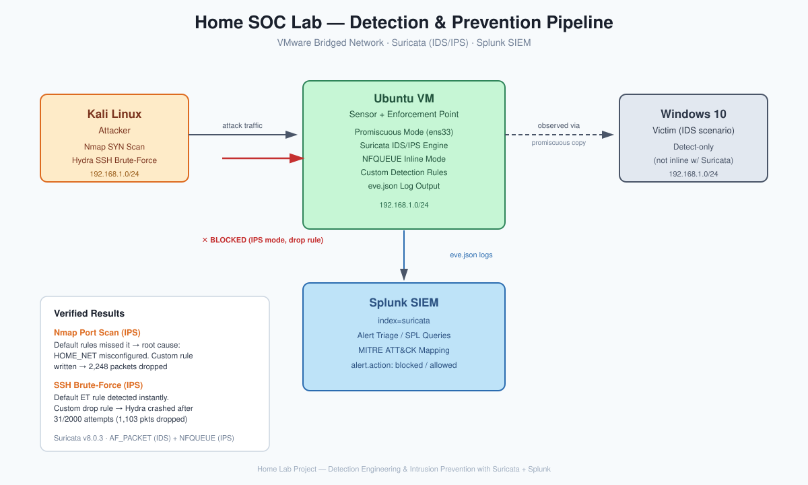

# Home SOC Lab: Detection Engineering &amp; Intrusion Prevention with Suricata + Splunk

A hands-on home lab project simulating real-world SOC analyst and detection engineering
workflows — from network traffic capture and SIEM integration, through detection-gap
analysis and custom rule authoring, to converting an IDS into a working inline IPS that
actively blocks live attacks.



## Overview

Most home-lab writeups stop at "I set up an IDS and it generated alerts." This project
goes further: it identifies *why* a well-known attack technique was **not** detected by
default rules, fixes the root cause, writes original detection logic, and then proves
the detection can be converted into active prevention — with before/after packet
statistics from Suricata itself.

## Lab Environment

| Component | Role | Details |
|---|---|---|
| Ubuntu VM | Sensor / enforcement point | Suricata 8.0.3 + Splunk, `ens33` interface |
| Kali Linux | Attacker | Nmap, Hydra |
| Windows 10 | Victim (IDS-only scenario) | Used for the initial detect-only Nmap test |
| VMware Workstation | Hypervisor | Bridged networking, all VMs on `192.168.1.0/24` |

**Why Bridged mode:** Suricata needs to see traffic that isn't addressed to its own
interface. Bridged networking plus **promiscuous mode** on Ubuntu's `ens33` adapter lets
the sensor observe Kali ↔ Windows traffic even though Ubuntu isn't a party to those
conversations — verified directly with `tcpdump` before any detection work began.

## Pipeline

```
Kali (attacker) → network → Ubuntu (Suricata sensor) → eve.json → Splunk (index=suricata)
```

For the IPS phase, Ubuntu itself became the target so that Suricata could sit **inline**
(via `NFQUEUE` + `iptables`) rather than just observing a promiscuous copy of traffic —
inline positioning is a hard requirement for actually dropping packets, not just seeing
them.

## Part 1 — IDS Baseline: Suricata + Splunk Integration

- Verified promiscuous capture with `tcpdump` (Ubuntu could see Kali ↔ Windows traffic
  it wasn't a party to).
- Confirmed `eve.json` → Splunk log ingestion (`index=suricata`), validated with SPL:
  ```spl
  index="suricata" event_type=alert | stats count by event_type
  ```
- Baseline: 13,962 events indexed across `alert`, `flow`, `dns`, `http`, `tls`, `fileinfo`.

## Part 2 — Detection Gap: Nmap Port Scan

**Attack:** `nmap -sS -sV -p- <target>` (full 65535-port SYN scan) from Kali against
Windows 10.

**Finding:** Zero scan-related alerts, even after downloading a fresh Emerging Threats
Open ruleset via `suricata-update`. Two issues were diagnosed and fixed in sequence:

1. **Wrong rule file location** — `local.rules` had been created in `/etc/suricata/rules/`,
   but Suricata's `default-rule-path` pointed to `/var/lib/suricata/rules/`. Custom rules
   were silently never loaded.
2. **Misconfigured `HOME_NET`** — `suricata.yaml` still had a stale
   `HOME_NET: "192.168.181.130/24"` from an earlier network configuration, while the lab
   had since moved to Bridged mode on `192.168.1.0/24`. Any rule referencing `$HOME_NET`
   as the destination could never match real traffic.

**Custom detection rule** (after fixing both issues):

```
alert tcp any any -> $HOME_NET any (msg:"CUSTOM Nmap SYN Scan"; flags:S; flow:stateless;
threshold:type both, track by_src, count 20, seconds 60; classtype:attempted-recon;
sid:1000002; rev:1;)
```

**Logic:** 20+ SYN-only packets from one source within a 60-second window is treated as
reconnaissance, independent of which specific ports are hit — this catches the *behavior*
of a scan rather than any single signature.

**Result:** 11 alerts fired over the course of a full-port scan, matching the expected
once-per-threshold-window firing pattern.

## Part 3 — IDS → IPS: Converting Detection into Prevention

Detecting an attack is only half the job. To actually **block** it, Suricata was moved
from passive `AF_PACKET` capture into **inline NFQUEUE mode**:

```bash
sudo iptables -I INPUT  -j NFQUEUE --queue-num 0
sudo iptables -I OUTPUT -j NFQUEUE --queue-num 0
sudo suricata -q 0 -c /etc/suricata/suricata.yaml -v
```

The detection rule's action was changed from `alert` to `drop`:

```
drop tcp any any -> $HOME_NET any (msg:"CUSTOM Nmap SYN Scan - BLOCKED"; flags:S;
flow:stateless; threshold:type both, track by_src, count 20, seconds 60;
classtype:attempted-recon; sid:1000002; rev:2;)
```

**Verification:** A repeat full-port Nmap scan against Ubuntu, now targeted directly
(since inline enforcement only applies to traffic Suricata sits in the path of), went
from completing in ~5 minutes to still being at **0.62% after nearly 13 minutes** —
direct evidence that packets were being silently dropped rather than answered.

**Session totals from Suricata itself:**

| Metric | Value |
|---|---|
| Packets treated | 124,548 |
| Accepted | 122,300 |
| **Dropped** | **2,248** |
| Alerts | 325 |

Confirmed in Splunk with `alert.action="blocked"` on the custom signature.

## Part 4 — SSH Brute-Force: A Different Detection Story

**Attack:** `hydra -l ubuntu -P <wordlist> ssh://<target>` — first a 10-password test,
then a 2,000-password list sourced from `rockyou.txt`.

**Finding:** Unlike the Nmap scan, this was detected **immediately by the default
Emerging Threats ruleset** — no custom rule was needed for detection:

- `ET SCAN LibSSH Based Frequent SSH Connections Likely BruteForce Attack`
- `ET SCAN Potential SSH Scan OUTBOUND`
- `ET SCAN Potential SSH Scan`

This is a useful contrast for understanding rule design: SSH brute-forcing is a
well-known, narrowly-defined behavior pattern that the ET ruleset already models tightly,
whereas a raw SYN scan is generic enough that it fell outside the default ruleset's
coverage.

**Custom IPS rule** (stricter threshold than the scan rule, since legitimate SSH clients
rarely retry this fast):

```
drop tcp any any -> $HOME_NET 22 (msg:"CUSTOM SSH Brute Force - BLOCKED"; flags:S;
flow:stateless; threshold:type both, track by_src, count 5, seconds 60;
classtype:attempted-recon; sid:1000003; rev:1;)
```

**Result — small test (10 passwords):** Blocked/allowed pair confirmed in Splunk
(`alert.action=blocked`) within the same second the threshold was crossed.

**Result — large test (2,000 passwords):** Only **31 of 2,000** attempts completed
before Hydra itself failed:

```
[ERROR] all children were disabled due too many connection errors
[ERROR] 1 target was disabled because of too many errors
```

The attack tool was effectively disabled by the volume of dropped connections before it
could make meaningful progress — a stronger practical outcome than the Nmap case, where
the scan merely slowed down rather than failing outright.

**Session totals:** 128,926 packets treated, 1,103 dropped, 373 alerts over ~21 minutes.

## Key Takeaways

- **Detection is not one-size-fits-all.** A generic recon technique (port scanning)
  needed original detection logic; a well-known credential attack (SSH brute-force) was
  already covered by community rules.
- **Configuration drift breaks detection silently.** Both root causes in Part 2 —
  wrong rule directory, stale `HOME_NET` — produced *no errors*, just quiet non-detection.
  Suricata reported "rules successfully loaded" the whole time; only cross-checking
  against Splunk and the actual network exposed the gap.
- **IDS and IPS are architecturally different.** Passive promiscuous capture cannot
  block traffic. Verifying that required rebuilding the lab's traffic path (Kali → Ubuntu
  inline) rather than just changing a config flag.
- **Effectiveness varies by attack type.** The same blocking mechanism produced a
  *slowdown* against Nmap but a full *tool failure* against Hydra — worth understanding
  when tuning thresholds for production use.

## Repository Contents

- `architecture-diagram.svg` — network and pipeline diagram
- `incident-reports.md` — detailed, timeline-based write-ups for both attacks
- `local.rules` — the three custom Suricata rules developed in this project

## Tools Used

Suricata 8.0.3 · Splunk · Kali Linux (Nmap, Hydra) · Ubuntu 24.04 · VMware Workstation
